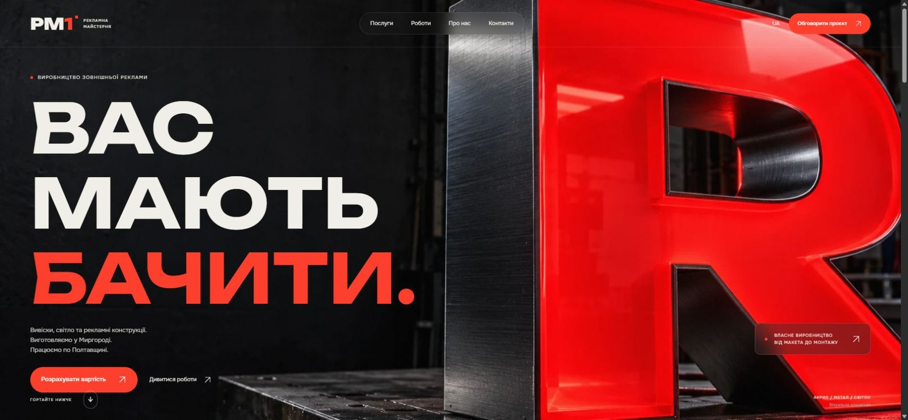

# РМ1 / Реклама, яку видно

Ukrainian service catalogue and portfolio for a custom advertising workshop in Myrhorod, Poltava region.

[Live site](https://veyotscaled.github.io/rm1-reklama/)



11 static pages: home, catalogue, five service pages, filtered portfolio, about, contacts, and privacy. A continuous project ribbon responds to scrolling, the hero uses a typographic entrance, pointer interactions support the interface, and a Three.js dimensional letter demonstrates metal and illuminated acrylic.

The quote form validates entries and prepares an email. The visitor sends it through their own mail app or copies the request for a messenger. There is no backend or automatic lead delivery. No storefront, checkout, invented prices, reviews, or metrics.

## Run locally

Node.js 20 or later. No package installation required.

```sh
node build.mjs
node server.mjs
```

Open http://127.0.0.1:4173/.

```sh
node --check app.js
node --check motion.js
node --check sign-scene.js
node verify.mjs
```

`content.js` contains service and project copy. `build.mjs` generates HTML pages. `styles.css` contains the responsive design. `app.js` handles menus, filters, photo dialogs, and quote preparation. `motion.js` contains GSAP and Lenis choreography; `sign-scene.js` owns the on-demand 3D material study.

Runtime fonts, images and libraries are local. The website respects reduced motion and retains a static 3D fallback. GitHub Pages publishes the repository root; relative asset paths support the repository subpath.

## Assets and rights

See [ASSETS.md](ASSETS.md) for exact image and library sources. Real portfolio photographs come from the client's website. The hero, directory plaque and vehicle service illustration are original generated concepts, labelled on the site. References informed high-level composition and interactions; their content and visual assets were not copied.

This is a client review concept. No general reuse license has been granted for the project or client assets. Third-party libraries and fonts retain their own licenses.
